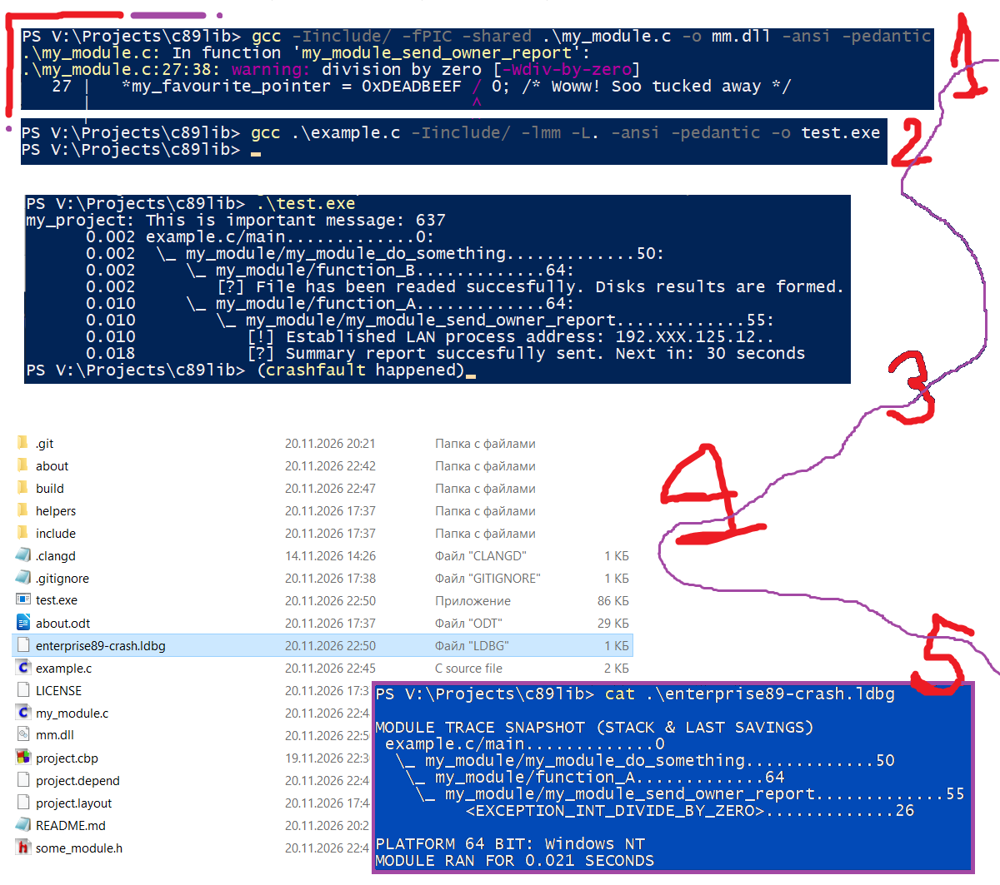

# Lightweight Debugging (ldbg.h)
A header-only library from c89lib collection used to give CXX developers all sorts of <br>
features for debugging programs. Manual instrumentation by library tools will transform <br>
your source texts into powerful and flexible debug contents you control via few options.

## Call Stack Observability without Binary Debug Symbols
``` dbgfnjmp() ``` : Begin new call entry in stack: function name, translation unit name, line number. <br>
``` dbgfnsav() ``` : Save current line number as call's latest checkpoint before potential crash. <br>
``` dbgfnret() ``` : Final this call entry in stack. Restore and back to parent call's state. <br>

## Log Flows with Effecient Selective Run-Time Management
``` dbgfninf(text, ...) ``` : Inform assigned to the call, variadic-format based information. <br>
``` dbgfnwrn(text, ...) ``` : Warn assigned to the call, variadic-format based warning. <br>
``` dbgfnmsk(mask, option) ``` : Assign further call assigned outputs to the logical meaning. <br> 
``` dbgmsk(mask) ``` *(lvalue)* : Select logical meaning you're interested to view in run-time. <br>
___
``` dbgfnmsk(RESET, MASK) ``` : Is reserved keywords to reset function assigned masks combination. <br>
``` dbgfnmask(mask, EVERYTHING) ``` : Is reserved keyword to assign function to all options in mask. <br>

## Base Logging and Crashfault Unexpected-Handling
``` dbginstall(handler, writer) ``` : Install process' crashfault handler. Allows specifying custom behaviour. <br>
``` dbglog(level, format, ...) ``` : Log out into platform channel satisfying given message's level. <br>
___
``` LDBG_INFO ``` : Level of normal information. Windows: stdout. Linux: stdout. Android: logcat(info). <br>
``` LDBG_ERROR ``` : Level of error information. Windows: stderr. Linux: stderr. Android: logcat(error). <br>
``` LDBG_DEBUG ``` : Level of debug information. Windows: debugger. Linux: syslog. Android: logcat(debug). <br>
___
``` LDBG_CRASHFAULT_BEGIN ``` : Signal custom crashfault writer will receive before default contents will be sent. <br>
``` LDBG_CRASHFAULT_FINAL ``` : Signal custom crashfault writer will receive after default contents sent. <br>

## Multithreaded Intermodular Share of Debug Objects
``` dbgsuite ``` *(lvalue*) : Access to thread debug suite, currently loaded. View stack, error, cursor and etc. <br>
``` dbgdef(log, out) ``` *(debug89)* : Define debug suite with specified log function and out object. <br>
``` dbgload(&suite, entries[], message[], timer) ``` : Load debug for thread. Assign stack, buffer, timer. <br>
``` dbgmskdecl(abi, mask) ``` : Declare a mask with ABI visibility. It can be: extern, export, import keywords. <br>
``` dbgmskoptn(mask, option, bit) ``` : Declare a logical meaning within mask. The capacity is 64 options/bits. <br>
``` dbgmskimpl(mask) ``` : Implement library accessors in one translation unit for declared mask. <br>

## Compile-Time Control Options of Library Functionality
``` LDBG_HELP_LEVEL ``` : 0 - only error access. 1 - shadow stack and base log. ***2*** - masked stack-tree without base log. <br>
``` LDBG_SYMBOLS_DB ``` : ***0*** - no assembly instructions for function borders; 1 - guaranteed assembly labels for borders. <br>
``` LDBG ``` : the text name of logical unit, the debugging outputs belows to. ***Default: Translation Unit Filename*** <br>

___

#### Example 1. The Comprehensive Usage of LDBG.H with External Module
```c
#define LDBG "my_project" /* Define this to specify the prefix of unit's debug messages */
#define LDBG_HELP_LEVEL 1 /* Define this to specify the preffered help level from ldbg */

#define CENLIB_IMPLEMENT  /* Define this to include implementation on c89lib's ldbg.h  */
#include <c89lib/ldbg.h>
#include <c89lib/time.h>
#include "some_module.h"


static void
crashpad_writer(const char *text)
/* To/do: Temporary Bad-Practices! Further, use ASYNC-SIGNAL-SAFE, please */
{
    static FILE *my_dump = NULL;
    const char *reader = text;
    size_t length = 0;

    if (text == LDBG_CRASHFAULT_BEGIN) {
        /* In this scope we should prepare our crash writer */
        /* You can insert custom data to crash dump, like binary stack */
        my_dump = fopen("enterprise89-crash.ldbg", "w");
        return;
    } else if (text == LDBG_CRASHFAULT_FINAL) {
        /* In this scope we should finalize our crash writer */
        /* Enterprise Edition could have user-friendly dialog pop & up! */
        fclose(my_dump);
        return;
    }

    for (; *reader != '\0'; ++reader, ++length);
    fwrite(text, length, 1, my_dump);
}

void
function(int a, int b)
{
  dbgfnjmp();
  dbgfnwrn("Hello from Function! My args is %d %d\n", a, b);
  dbgsuite->error = (intptr_t) (a + b); /* Always accessible */ 
  dbgfnret();
}

int
main(void)
{
  trace89 entries[16]; char message[128]; /* The call stack depth is 16 */
  debug89 suite = dbgdef(&fprintf, stdout); /* You could change it to UART */
  dbgload(&suite, entries, message, &dtruntime); /* I will use my process timer */

  dbginstall(NULL, &crashpad_writer); /* Install default crashfault handler in our view-way */
  dbgmsk(MY_MODULE_DEBUG_LOGIC) &= ~MY_MODULE_DEBUG_LOGIC_WORKER_A; /* Mute module Worker A */
  my_module_configure_ldbg(dbgsuite, &dtruntime); /* Executable sharing with module */

  dbgfninf("Hello from Main! I'm using LDBG.H module!\n");
  function(125, 512); /* First, we could run our, executable-file function */
  dbglog(LDBG_INFO, "This is important message: %d\n", (int) dbgsuite->error);
  my_module_do_something(); /* Now, we could run external, module function */

  return 0;
}
```

#### Example 2. The Demonstrative Module sharing Executable Debug Objects
```c
/* This is some_module.h */
#if !defined(COMPANY_SOME_MODULE_INCLUDED)
#define COMPANY_SOME_MODULE_INCLUDED 1

#include <c89lib/abpi.h>
#include <c89lib/ldbg.h>

#if defined(MY_MODULE_COMPILING)
  #define API abpi_export /* I will use symbol ABI's visibility modifier from c89lib/abpi.h */
#else /* MY_MODULE_COMPILING */
  #define API abpi_import /* The executable will import module functionality, the module will export */
#endif /* !MY_MODULE_COMPILING */

dbgmskdecl(API, MY_MODULE_DEBUG_LOGIC) /* Module will export these masks, executable will import */
dbgmskoptn(MY_MODULE_DEBUG_LOGIC, WORKER_A, 0) /* Define an option WORKER_A for others to manage */
dbgmskoptn(MY_MODULE_DEBUG_LOGIC, WORKER_B, 1) /* Define an option WORKER_B for others to manage */
dbgmskdecl(API, MY_MODULE_DEBUG_TYPE) /* By the way, you can use extern keyword for internal in-lib usage */
dbgmskoptn(MY_MODULE_DEBUG_TYPE, DISK, 0) /* Define an option type DISK as worker classification */
dbgmskoptn(MY_MODULE_DEBUG_TYPE, NETWORK, 1) /* Define an option type NETWORK as worker classification */

API void my_module_do_something(void);
API void my_module_configure_ldbg(void *exe_suite, double (*timer)(void));
#endif /* COMPANY_SOME_MODULE_INCLUDED */
```

```c
/* This is some_module.c */
#define LDBG "my_module"  /* Our module will be printing its messages with "my_module/" prefix */
#define LDBG_HELP_LEVEL 2 /* Our module will be compiled with the support of tree-stack printing */

#define CENLIB_IMPLEMENT  /* Every project will use it ldbg implementation depending on HELP level */
#include <c89lib/ldbg.h>
#define MY_MODULE_COMPILING
#include "some_module.h"


/* Provide a single implementation to masks */
dbgmskimpl(MY_MODULE_DEBUG_LOGIC)
dbgmskimpl(MY_MODULE_DEBUG_TYPE)


static void
my_module_send_owner_report(void)
{
  int *my_favourite_pointer = NULL;
  
  dbgfnjmp();
  dbgfnmsk(MY_MODULE_DEBUG_TYPE, NETWORK); /* Assign this function only to NETWORK */

  dbgfnwrn("Established LAN process address: %s..\n", "192.XXX.125.12");
  /* Here we are doing some send/recv logic... and, oopsie, we will cause a crash! */
  dbgfninf("Summary report succesfully sent. Next in: %d seconds\n", 30);
  *my_favourite_pointer = 0xDEADBEEF / 0; /* Woww! Soo tucked away */

  dbgfnret();
}

static int
function_B(void)
{
  dbgfnjmp();
  dbgfnmsk(MY_MODULE_DEBUG_LOGIC, WORKER_B); /* This function assigns to WORKER_B */
  dbgfnmsk(MY_MODULE_DEBUG_TYPE, DISK); /* This function also assigns to DISK */

  /* We're doing here some heavy operations with disk I/O calculating (for example) */
  dbgfninf("File has been readed succesfully. Disks results are formed.\n");
  
  dbgfnret();
  return 0xDEADBEEF;
}

static void
function_A(int disk_results)
{
  dbgfnjmp();
  dbgfnmsk(MY_MODULE_DEBUG_LOGIC, WORKER_A); /* This function assigns to WORKER_A */
  dbgfnmsk(MY_MODULE_DEBUG_TYPE, NETWORK); /* This function also assigns to NETWORK */

  dbgfninf("Please, wait until the disk results will be loaded on server: %d\n", disk_results);
  /* Here we are performing some network logic, like sending data on server (for example) */
  dbgfninf("The results are sent. Now we're sendind the summary report to LAN process..\n");
  my_module_send_owner_report(); /* We are giving control to another one network function */

  dbgfnret();
}

void
my_module_do_something(void)
{
  dbgfnjmp();
  function_A(function_B());
  dbgfnret();
}

void
my_module_configure_ldbg(void *exe_suite, double (*timer)(void))
{
  /* Now, every EXE thread can configure DLL/SO thread by calling this */
  /* We won't override entries/message buffers, so pass NULL both */
  dbgload(exe_suite, NULL, NULL, timer);
}
```

#### As you can see! My project was compiled with 1 help level, my module was compiled with 2 help level!
Look carefully. Project didn't log his call stack tree, while module did, when used debug resources shared <br>
from project. But project did his way in crashfault call stack history. This is ABI compatibility of help level. <br>
Also notice that project had muted module worker A. This is proof of intermodular debug resources cooperation. <br>

